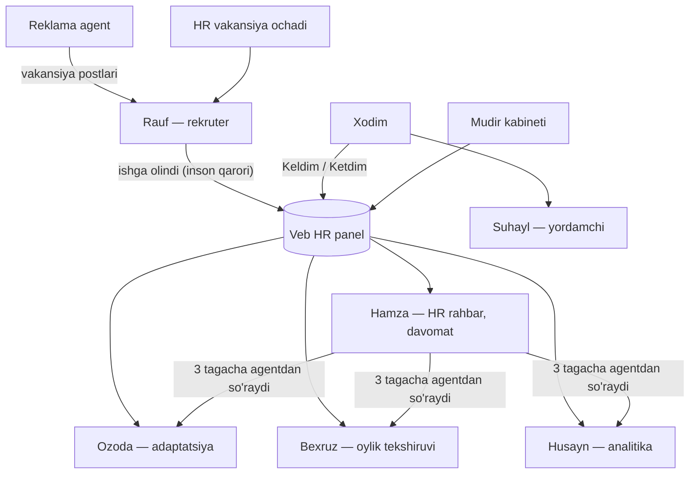

# hr-ai-skills

**[O'zbekcha](#ozbekcha) · [Русский](#русский) · [English](README.en.md)**

---

## O'zbekcha

HR bo'limi uchun **AI agentlar** yasashda va ishlatishda foydalanadigan Claude Code skill'larim, agent personalari va MCP server.

Men **Komron** ([@Kamron5505](https://github.com/Kamron5505)), **CEO AI team** kompaniyasining HR bo'limida AI agentlar dasturchisiman. Ishimning tarkibi:
- Telegram'dagi 7 ta AI agent;
- veb HR panel;
- bo'lim boshlig'i kabineti (Telegram Mini App).

Tizim **BioLife**'da (ichimlik suvi zavodi) NOVA-KIT nomi bilan ishlab turibdi va **Ozone** dorixonalar tarmog'iga moslashtirilmoqda.

Bu repozitoriyda o'sha ishning qayta ishlatiladigan qismi bor: agentlar amal qiladigan qoidalar, jarayonlar va promptlar, [Claude Code skill](https://docs.claude.com/en/docs/claude-code/skills) ko'rinishida. Kompaniya kodi, ma'lumotlari va serverlari bu yerda yo'q. Ishga tushiriladigan to'plam (backend, botlar, dashboard) alohida **yopiq** `hr-agents-kit` repozitoriyida.

### Skill'lar

**HR agentlar uchun**

| Skill | Nima qiladi | Agent |
|---|---|---|
| [hr-vacancy-writer](skills/hr-vacancy-writer/SKILL.md) | Erkin matndan qat'iy shablon bo'yicha vakansiya e'loni; maosh va telefonni o'ylab topmaydi | Rauf |
| [interview-scorer](skills/interview-scorer/SKILL.md) | Suhbatni 4 mezon bo'yicha baholaydi (40/25/15/20). Avto-rad yo'q, himoyalangan belgilar bo'yicha savol yo'q | Rauf |
| [payroll-precheck](skills/payroll-precheck/SKILL.md) | To'lovdan oldin oylikni tekshiradi va xato to'lanishi mumkin bo'lgan summani ko'rsatadi; tasdiqlamaydi | Bexruz |
| [attendance-report](skills/attendance-report/SKILL.md) | 09:00 / 18:30 davomat hisoboti qat'iy formatda; "belgilamagan" degani "kelmagan" emas | Hamza |
| [onboarding-30-60-90](skills/onboarding-30-60-90/SKILL.md) | 30/60/90 kunlik reja, ustoz, test bali, svetofor | Ozoda |
| [sop-librarian](skills/sop-librarian/SKILL.md) | Lavozim yoki so'z bo'yicha yo'riqnoma (SOP) qidiradi; matnni o'zi yozmaydi | Ozoda, Suhayl |
| [hr-analytics-explainer](skills/hr-analytics-explainer/SKILL.md) | HR raqamlarini baza va davr bilan tushuntiradi; kichik guruhda % emas, son beradi | Husayn |
| [employee-helpdesk](skills/employee-helpdesk/SKILL.md) | Xodimga faqat o'z ma'lumotlari bo'yicha javob beradi va ariza ochadi | Suhayl |
| [channel-ads-negotiator](skills/channel-ads-negotiator/SKILL.md) | Telegram kanallarda vakansiya reklamasini byudjet doirasida kelishadi; pulni doim inson to'laydi | Reklama |
| [human-in-the-loop-guard](skills/human-in-the-loop-guard/SKILL.md) | Faqat inson qabul qiladigan 7 qaror, tasdiq so'rovi, audit | Hammasi |
| [tsenzura-censor](skills/tsenzura-censor/SKILL.md) | O'zbek/rus matnida so'kinish va shaxsiy ma'lumotni yashirish | Hammasi |
| [hr-rollout-playbook](skills/hr-rollout-playbook/SKILL.md) | Yangi kompaniyaga joriy qilish: 0–6 bosqichlar, ma'lumotlar ro'yxati, pilot | Dasturchi |

**Kod, dashboard va formatlash uchun**

| Skill | Nima qiladi |
|---|---|
| [default-stack](skills/default-stack/SKILL.md) | **Standart stek.** AI agent qaysi texnologiyani ishlatishni o'zi biladi va so'ramaydi: FastAPI, SQLAlchemy, aiogram, Claude API, React + Vite, Docker, hamda qoidalar |
| [telegram-rich-format](skills/telegram-rich-format/SKILL.md) | Telegram xabar, hisobot va alertlarni chiroyli formatlash (HTML, premium emoji, tg-time); validator `tgfmt.py` bilan |
| [screens-overview](skills/screens-overview/SKILL.md) | Ilova yoki Mini App'ning barcha ekranlarini bitta grid rasmga yig'adi |
| [redesign-mockup](skills/redesign-mockup/SKILL.md) | Namuna dizayndan (Pinterest/Dribbble) butun ilovaning yangi dizayn maketini chizadi |
| [perf-lag-audit](skills/perf-lag-audit/SKILL.md) | Qotish va sekinlikni o'lchab topadi va tuzatadi, oldin/keyin raqamlari bilan |
| [security-audit](skills/security-audit/SKILL.md) | Tezkor xavfsizlik tekshiruvi: Strix (bo'lsa) va qo'lda tekshirish ro'yxati |
| [cloudflare-security-audit](third_party/cloudflare-security-audit/) | Cloudflare'ning chuqur xavfsizlik auditi metodikasi (MIT, o'zgartirilmagan, [manba](https://github.com/cloudflare/security-audit-skill)) |

Shuningdek:
- [`personas/`](personas/) — 7 agentning tizim promptlari shablonlari;
- [`mcp-server/`](mcp-server/) — CSV ma'lumotlar ustida faqat o'qiydigan HR asboblari bilan demo MCP server.

### O'rnatish

```powershell
# Windows PowerShell
./scripts/install.ps1            # ~/.claude/skills/ ga
./scripts/install.ps1 -Project   # joriy loyihaning ./.claude/skills/ ga
```

```bash
# macOS / Linux / Git Bash
./scripts/install.sh
./scripts/install.sh --project
```

Cloudflare skill'i `cloudflare-security-audit` nomi bilan o'rnatiladi. Kerak bo'lmasa: `-NoThirdParty` / `--no-third-party`.

### Asosiy qoidalar

- Agentlar **7 qarorni qabul qilmaydi**: oylikni tasdiqlash, ushlab qolish, shartnomani o'zgartirish, ishga olish, ishdan bo'shatish, ommaviy xabar yuborish va arizani tasdiqlash. Bu qarorlarni faqat inson qabul qiladi.
- Filial (dorixona) bo'yicha ruxsat promptda emas, **kodda** tekshiriladi.
- Noma'lum qiymat `—` bilan ko'rsatiladi, 0 bilan emas. Har bir raqam baza va davr bilan beriladi.

---

## Русский

Мои скиллы для Claude Code, персоны агентов и MCP-сервер, с которыми я создаю и запускаю **ИИ-агентов для HR-отдела**.

Я **Комрон** ([@Kamron5505](https://github.com/Kamron5505)), разработчик ИИ-агентов в HR-департаменте компании **CEO AI team**. Моя работа:
- 7 ИИ-агентов в Telegram;
- веб HR-панель;
- кабинет заведующего (Telegram Mini App).

Система работает в **BioLife** (завод питьевой воды) под названием NOVA-KIT и адаптируется для сети аптек **Ozone**.

В этом репозитории лежит переиспользуемая часть этой работы: правила, процедуры и промпты агентов в виде [скиллов Claude Code](https://docs.claude.com/en/docs/claude-code/skills). Кода, данных и серверов компании здесь нет. Готовый к развёртыванию комплект (бэкенд, боты, дашборд) — в отдельном **приватном** репозитории `hr-agents-kit`.

### Скиллы

**Для HR-агентов**

| Скилл | Что делает | Агент |
|---|---|---|
| [hr-vacancy-writer](skills/hr-vacancy-writer/SKILL.md) | Вакансия из свободного текста по строгому шаблону; зарплату и телефоны не выдумывает | Rauf |
| [interview-scorer](skills/interview-scorer/SKILL.md) | Оценка интервью по 4 критериям (40/25/15/20). Без автоотказа, без вопросов о защищённых признаках | Rauf |
| [payroll-precheck](skills/payroll-precheck/SKILL.md) | Проверка зарплаты до выплаты и сумма, которая может уйти неправильно; не утверждает | Bexruz |
| [attendance-report](skills/attendance-report/SKILL.md) | Отчёт посещаемости 09:00 / 18:30 в фиксированном формате; «не отметился» ≠ «не пришёл» | Hamza |
| [onboarding-30-60-90](skills/onboarding-30-60-90/SKILL.md) | План 30/60/90, наставник, баллы тестов, светофор | Ozoda |
| [sop-librarian](skills/sop-librarian/SKILL.md) | Поиск инструкций (SOP) по должности или слову; текст сам не пишет | Ozoda, Suhayl |
| [hr-analytics-explainer](skills/hr-analytics-explainer/SKILL.md) | Объясняет HR-цифры с базой и периодом; для малых групп — число, а не % | Husayn |
| [employee-helpdesk](skills/employee-helpdesk/SKILL.md) | Отвечает сотруднику только про его собственные данные и оформляет заявки | Suhayl |
| [channel-ads-negotiator](skills/channel-ads-negotiator/SKILL.md) | Договаривается о рекламе вакансий в Telegram-каналах в рамках бюджета; платит всегда человек | Реклама |
| [human-in-the-loop-guard](skills/human-in-the-loop-guard/SKILL.md) | 7 решений, которые принимает только человек, запрос на одобрение, аудит | Все |
| [tsenzura-censor](skills/tsenzura-censor/SKILL.md) | Маскирование мата и персональных данных в узбекском и русском тексте | Все |
| [hr-rollout-playbook](skills/hr-rollout-playbook/SKILL.md) | Запуск у новой компании: фазы 0–6, чек-лист данных, пилот | Разработчик |

**Для кода, дашбордов и форматирования**

| Скилл | Что делает |
|---|---|
| [default-stack](skills/default-stack/SKILL.md) | **Стек по умолчанию.** ИИ-агент сам знает, на чём писать, и не спрашивает: FastAPI, SQLAlchemy, aiogram, Claude API, React + Vite, Docker, плюс общие правила |
| [telegram-rich-format](skills/telegram-rich-format/SKILL.md) | Красивое оформление сообщений, отчётов и алертов в Telegram (HTML, премиум-эмодзи, tg-time), с валидатором `tgfmt.py` |
| [screens-overview](skills/screens-overview/SKILL.md) | Все экраны приложения или Mini App в одной картинке-сетке |
| [redesign-mockup](skills/redesign-mockup/SKILL.md) | Макет редизайна всего приложения по референсу (Pinterest/Dribbble) |
| [perf-lag-audit](skills/perf-lag-audit/SKILL.md) | Находит и чинит лаги по замерам, с цифрами до и после |
| [security-audit](skills/security-audit/SKILL.md) | Быстрая проверка безопасности: Strix (если установлен) и ручной чек-лист |
| [cloudflare-security-audit](third_party/cloudflare-security-audit/) | Глубокий аудит безопасности по методике Cloudflare (MIT, без изменений, [источник](https://github.com/cloudflare/security-audit-skill)) |

Также в репозитории:
- [`personas/`](personas/) — шаблоны системных промптов всех 7 агентов;
- [`mcp-server/`](mcp-server/) — демо MCP-сервер с HR-инструментами только для чтения поверх CSV-данных.

### Установка

```powershell
# Windows PowerShell
./scripts/install.ps1            # в ~/.claude/skills/
./scripts/install.ps1 -Project   # в ./.claude/skills/ текущего проекта
```

```bash
# macOS / Linux / Git Bash
./scripts/install.sh
./scripts/install.sh --project
```

Скилл Cloudflare ставится под именем `cloudflare-security-audit`. Если он не нужен, добавьте `-NoThirdParty` / `--no-third-party`.

### Главные принципы

- **7 решений агенты не принимают**: утверждение зарплаты, удержание, изменение договора, найм, увольнение, массовая рассылка и одобрение заявки. Их принимает только человек.
- Доступ по филиалу (аптеке) проверяется **в коде**, а не в промпте.
- Неизвестное значение показывается как `—`, а не 0. Каждая цифра — с базой и периодом.



License: MIT (`LICENSE`). Third-party: `third_party/cloudflare-security-audit/LICENSE` (MIT, Cloudflare, Inc.).
