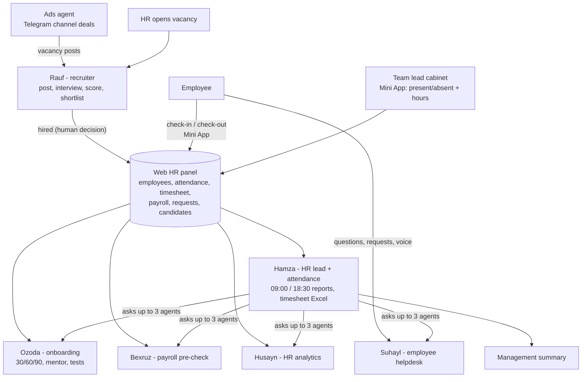

# hr-ai-skills

Claude Code skills, agent personas and an MCP server that I use to build and run **AI agents for an HR department**.

I'm **Komron** ([@Kamron5505](https://github.com/Kamron5505)), an AI agent developer in the HR department at **CEO AI team**. My work is a system of 7 Telegram AI agents, a web HR panel and a team-lead cabinet (Telegram Mini App). It runs in production at **BioLife** (a drinking-water factory) under the name NOVA-KIT, and is being adapted for **Ozone**, a pharmacy chain.

This repo is the reusable part of that work: the rules, procedures and prompts the agents follow, written as portable [Claude Code skills](https://docs.claude.com/en/docs/claude-code/skills). Company-specific code, data and infrastructure are not here. The deployable kit (backend, bots, dashboard) lives in a separate **private** repo, `hr-agents-kit`.

## Skill catalog

| Skill | What it does | Used by agent |
|---|---|---|
| [hr-vacancy-writer](skills/hr-vacancy-writer/SKILL.md) | Turns a free-text request into a vacancy post using a fixed template. Never makes up a salary or phone number | Rauf |
| [interview-scorer](skills/interview-scorer/SKILL.md) | Scores interview answers on 4 weighted criteria (40/25/15/20). No auto-reject, no questions about protected attributes | Rauf |
| [payroll-precheck](skills/payroll-precheck/SKILL.md) | Checks payroll before payout and reports how much money is at risk of being paid wrong. Never approves | Bexruz |
| [attendance-report](skills/attendance-report/SKILL.md) | Morning/evening attendance report in a fixed format. "Not checked in" never means "absent" | Hamza |
| [onboarding-30-60-90](skills/onboarding-30-60-90/SKILL.md) | 30/60/90-day plans, mentor, test scores, traffic light | Ozoda |
| [sop-librarian](skills/sop-librarian/SKILL.md) | Finds SOPs (standard operating procedures) by role or keyword. Never writes SOP text itself | Ozoda, Suhayl |
| [hr-analytics-explainer](skills/hr-analytics-explainer/SKILL.md) | Explains HR numbers with the base and period. Gives counts instead of % for small groups | Husayn |
| [employee-helpdesk](skills/employee-helpdesk/SKILL.md) | Answers employees' questions about their own data only, and files their requests | Suhayl |
| [channel-ads-negotiator](skills/channel-ads-negotiator/SKILL.md) | Negotiates vacancy ad placements in Telegram channels within a budget. A human always pays | Ads agent |
| [human-in-the-loop-guard](skills/human-in-the-loop-guard/SKILL.md) | The 7 decisions only a human can make, the approval-request pattern, audit | All |
| [tsenzura-censor](skills/tsenzura-censor/SKILL.md) | Profanity and personal-data masking for Uzbek/Russian free text | All |
| [hr-rollout-playbook](skills/hr-rollout-playbook/SKILL.md) | Rolls the system out to a new company: phases 0–6, data checklist, pilot | Developer |

There are also [`personas/`](personas/) (system-prompt templates for all 7 agents with `{{company_name}}` placeholders) and [`mcp-server/`](mcp-server/) (a demo MCP server with read-only HR tools over CSV data).

## Install

```bash
# macOS / Linux / Git Bash
./scripts/install.sh            # copies skills/* to ~/.claude/skills/
./scripts/install.sh --project  # copies to ./.claude/skills/ of the current project
```

```powershell
# Windows PowerShell
./scripts/install.ps1
./scripts/install.ps1 -Project
```

Or copy any folder from `skills/` by hand into `~/.claude/skills/`. Claude Code picks a skill up by its `description`.

## Architecture



- **One source of truth:** every agent reads the same HR panel through a read-only agent API.
- **Role first, then tools:** the role comes from the Telegram ID plus the job title in the database, and the model only sees tools allowed for that role. Users can't give themselves a role.
- **Data is not commands:** user text, CVs and channel-admin messages are treated as data.
- **Deterministic where it matters:** scheduled reports are built by code, not by the model. Unknown values show as "—", never 0.
- **Audit everything:** every message, tool call, edit and refusal is logged.

### The 7 human-only decisions

Agents never do these. They can only create an approval request:

1. Approve payroll
2. Create a deduction
3. Change an employment contract
4. Hire
5. Dismiss
6. Send a mass broadcast
7. Approve an employee request (leave, certificate, …)

See [human-in-the-loop-guard](skills/human-in-the-loop-guard/SKILL.md).

## Docs

- [Architecture](docs/architecture.md)
- [Case study: BioLife (factory)](docs/case-study-biolife.md)
- [Case study: Ozone (pharmacy chain adaptation)](docs/case-study-ozone-pharmacy.md)
- [Lessons learned](docs/lessons-learned.md)

## License

MIT. See [LICENSE](LICENSE).
